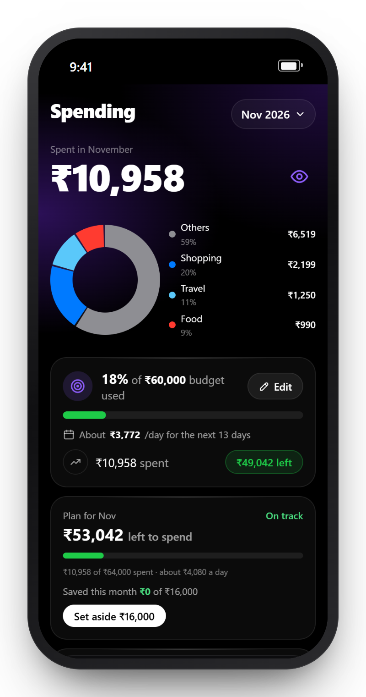

# JustMoney

[](LICENSE)


<p align="center">
  
</p>

<p align="center"><strong>Your money, on your phone, with almost no typing.</strong></p>

JustMoney is an open-source expense tracker for Android, made for India. It reads the payment messages and notifications your phone already receives, so most expenses are recorded for you. It also plans your month, splits bills with friends, and tracks accounts, loans, investments and savings. Everything stays on your phone: there is no account, no server and no cloud sync.

## Contents

- [Features](#features)
- [Privacy and security](#privacy-and-security)
- [Install](#install)
- [Permissions](#permissions)
- [Development](#development)
- [Building the Android app](#building-the-android-app)
- [Releasing](#releasing)
- [Project structure](#project-structure)
- [How it works](#how-it-works)
- [Tech stack](#tech-stack)
- [Limitations](#limitations)
- [Contributing](#contributing)
- [Security](#security)
- [License](#license)

## Features

**Recording expenses**
- Reads new bank and UPI messages from business senders, and payment-app notifications, while the app is closed.
- Adds a receipt, screenshot or PDF statement from the share sheet, the camera or the file picker. Text is read on the device.
- Understands short sentences: "450 swiggy dinner #friday", "tea 20, auto 100 and lunch 250".
- Imports bank statements and avoids duplicates when a payment arrives by both message and notification.

**Planning the month**
- A spending plan that saves first and shows what is left to spend, per day as well.
- Profiles for an employee, a business owner, someone who is both, a freelancer, a student, or other. The app shows the tools that fit the profile.
- Students get a monthly allowance with an optional spending limit and an optional fixed monthly saving.
- Bills, EMIs, subscriptions, recurring entries, reminders, a yearly-cost fund and a spending calendar.

**Splitting and lending**
- Split a bill in a group or privately with one friend. Each friend gets a pay link that opens their UPI app with the amount filled in, or a share card with a UPI QR code.
- Split a bill item by item from a photo of the bill, with tax and discounts shared in proportion.
- Track loans and IOUs, partial repayments, and money paid on someone else's behalf.

**Money overview**
- Accounts, cards, cash, and balances, with a net-worth page and its timeline.
- Investments, IPO applications and blocked money, with share prices and exchange rates.
- Trends, insights, a yearly recap card and monthly PDF reports.

**On the phone**
- Home-screen widgets for the balance, spending, recent transactions, budget, goals, bills and quick actions.
- App lock with a passcode, and biometric unlock where the phone supports it.
- Reminders and alerts, and a choice of app icons.

**Optional AI**
- Turn AI on in Settings and use your own Google Gemini API key. Nothing is sent without that consent. The app works fully without it.

## Privacy and security

- **No server.** JustMoney has no backend, no account system and no analytics. Your transactions, accounts and messages stay on the device.
- **Few network requests:** live share prices and exchange rates, the update check against GitHub (once a day, and can be turned off), and, if you turn it on, AI requests to Google Gemini with your own key. Links you open yourself, such as a WhatsApp share, are opened by your browser or app.
- **Encrypted storage.** The database values are encrypted with AES-256-GCM. The data key is wrapped by a key that stays in the Android Keystore.
- **Encrypted backups.** Backups are protected with a password you choose (PBKDF2-SHA256 and AES-256-GCM). Secrets such as the App Lock hash and API keys are never included in a backup.
- **Narrow message reading.** Only messages from business-style senders that look like a payment are kept. Other messages are ignored and never stored. Message text is not written to logs.
- **Fails closed.** If the encryption key cannot be used, the app refuses to save rather than writing data in plain text.
- **Content Security Policy** for the built web code, limiting connections to the services listed above.

Found a security problem? Please read [SECURITY.md](SECURITY.md) and report it privately.

## Install

Once installed, JustMoney checks GitHub for a newer release once a day (Settings → Updates). It sends a notification when one is out, and you install it from Settings → Updates.

1. Open the **Releases** page of this repository and download the latest `JustMoney-<version>.apk`.
2. Open the file on your phone. Android will ask you to allow installation from this source. Allow it for the browser or file manager you used.
3. Open JustMoney, set a name and your profile, and turn on the features you want.

JustMoney is not on the Play Store. Each release is built from a version tag by the GitHub Actions workflow in [`.github/workflows/release.yml`](.github/workflows/release.yml), and the APK is signed with the project's release key. The signing certificate is printed in the workflow log of each release.

**Requirements:** Android 8.0 (API 26) or newer.

## Permissions

JustMoney asks for permissions only for the features that need them. The Android permissions in the manifest are:

| Permission | Used for |
|---|---|
| Internet | live share prices and exchange rates; AI requests only if you turn them on |
| Read and receive SMS | reading new bank and UPI messages from business senders, and scanning your inbox for recent payments when you ask |
| Notification access | reading payment-app notifications (you grant this in the phone's settings) |
| Contacts | choosing friends for splits and loans |
| Biometrics | unlocking the app with your fingerprint or face |
| Notifications | reminders and alerts |
| Run at startup | scheduling reminders and backups again after a restart |
| Foreground service | the quick-add service |
| Vibrate | haptic feedback |
| Install apps | installing a newer JustMoney from Settings → Updates, after you confirm it |
| Storage (Android 9 and older only) | saving backups and reports where Android 9 and older require it |

## Development

Requirements: Node.js 22 or newer.

```bash
npm install
npm run dev        # the web version, at http://localhost:5173
npm test           # the unit test suite
npm run lint       # oxlint
npm run build      # type check, then the production build into dist/
```

The web version runs in a browser for development. Features that need the phone, such as reading messages, notifications, widgets and biometrics, are only available in the Android app.

## Building the Android app

Requirements: JDK 21 and the Android SDK (platform 36 and build-tools 36).

```bash
npm run build
npx cap sync android          # copies the web build into the Android project
cd android
./gradlew assembleDebug       # on Windows: gradlew.bat assembleDebug
```

The debug APK is written to `android/app/build/outputs/apk/debug/`.

A signed release build reads four environment variables: `JM_KEYSTORE_PATH`, `JM_KEYSTORE_PASSWORD`, `JM_KEY_ALIAS` and `JM_KEY_PASSWORD`. Without them, `assembleRelease` produces an unsigned APK.

## Releasing

1. Update the version in three places: `version` in `package.json`, `versionName` and `versionCode` in `android/app/build.gradle`, and `APP_VERSION` in `src/screens/Settings.tsx`. Each new release needs a higher `versionCode`.
2. Commit the change and create a tag that matches the version, for example `v0.1.0`.
3. Push the tag. The release workflow runs the tests, builds the signed APK, checks that the tag matches the app version, and publishes the APK on a GitHub release with generated release notes.

The workflow needs these repository secrets: `JM_KEYSTORE_BASE64` (the release keystore, base64-encoded), `JM_KEYSTORE_PASSWORD`, `JM_KEY_ALIAS` and `JM_KEY_PASSWORD`. Keep a backup of the keystore: a different key cannot update an installed release.

Pushes to `main` and pull requests run the continuous-integration workflow in [`.github/workflows/ci.yml`](.github/workflows/ci.yml): type check, tests, lint, web build and a debug APK.

## Project structure

```
src/
  App.tsx, main.tsx        start-up, navigation and the tab bar
  screens/                 one file per page (Home, Plan, Split, Planner, Settings …)
  components/              shared UI, grouped by feature
  lib/                     the logic, grouped by feature; no React code here
    core/                  storage, types, formatting, money basics
    accounts/              accounts, cards, cash, blocked money
    capture/               reading payments: messages, notifications, receipts, statements
    payees/                payees, contacts, shops, recurring detection
    plan/                  the spending plan, pots, savings, tax, profession rules
    split/                 shared bills, pay links, bill splitting
    invest/                investments, IPOs, prices and exchange rates
    backup/                encrypted backups, restores and file export
    notify/                notifications, alerts and the home-screen widget
    reports/               recap cards, year in money, monthly PDF report
public/                    app icons, brand logos, fonts, sounds, service worker
android/                   the Capacitor Android project
  app/src/main/java/app/justmoney/   native code: database, encryption, capture, widgets, backups
assets/readme/             images used by this README
```

Each test file sits next to the module it tests, for example `src/lib/plan/plan.test.ts` tests `src/lib/plan/plan.ts`.

## How it works

- **One storage door.** Every stored value goes through `src/lib/core/storage.ts`. On Android, values are written to an encrypted SQLite database through the native plugin. In the browser they are kept in `localStorage`.
- **Logic without UI.** The modules in `src/lib` are plain TypeScript and can be tested without rendering anything.
- **Totals from records.** Balances and totals are calculated from the stored transactions. They are not kept as separate numbers that could drift apart.
- **Native layer.** Reading messages and notifications, widgets, backups and biometrics are implemented in Java in `android/app/src/main/java/app/justmoney`.

## Tech stack

React 19, TypeScript, Vite, plain CSS · Capacitor 8 (Android) · Java for the native layer · Vitest and oxlint · jsPDF and pdf.js for reports and statements · Google ML Kit for on-device text recognition · qrcode for UPI codes.

## Limitations

- The app is for Android. The web version is for development and does not read messages or notifications.
- It reads only the message formats it has been taught. A bank or payment app that changes its message text may need an update.
- Two payments of the same amount within 15 minutes that have no reference number are counted as one. This is a deliberate trade-off to avoid double entries.
- The release build is not minified yet, so the APK is larger than it needs to be.

## Contributing

Contributions are welcome. Please read [CONTRIBUTING.md](CONTRIBUTING.md) first: it explains the privacy rules, the checks to run before you open a pull request, and the code conventions. Taking part means following the [Contributor Covenant](https://www.contributor-covenant.org/version/2/1/code_of_conduct/) code of conduct.

## Security

See [SECURITY.md](SECURITY.md). Please do not report security problems in public issues.

## License

JustMoney is released under the [MIT License](LICENSE). Copyright (c) 2026 Arya Sharma.

Third-party components and their licences are listed in [THIRD_PARTY_NOTICES.md](THIRD_PARTY_NOTICES.md). Some bundled brand logos and icons may have their own rights; see that file before you reuse them.

## Acknowledgements

Built with [Capacitor](https://capacitorjs.com/), [React](https://react.dev/), [Vite](https://vite.dev/), [pdf.js](https://mozilla.github.io/pdf.js/), [jsPDF](https://github.com/parallax/jsPDF), [qrcode](https://github.com/soldair/node-qrcode), [Google ML Kit](https://developers.google.com/ml-kit) and the [Hind and Kalam](https://fonts.google.com/) typefaces.
